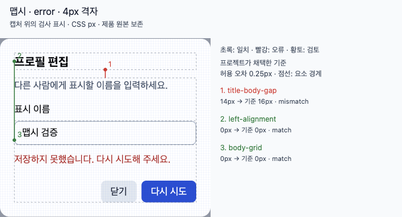

# 개발 중인 격자·영역별 화면 검사 검증

2026-11-27의 저장소 소스 검증입니다. 공개 1.0.0의 배포·설치본 검증과 구분하며 기존 미커밋 검사 지침을 보존했습니다. 실제 제품 코드·운영 데이터는 변경하지 않았습니다.

## 추가 구성

- [격자 입력·도구](../../plugins/mapsee/skills/lint/references/grid.md): PNG와 실제 CSS 경계에서 gap·alignment·grid 관계를 계산하고 원본 이미지를 포함한 별도 SVG를 생성합니다. 기본 간격은 4px이며 미채택 기준은 review로 유지합니다.
- [영역별 화면 절차](../../plugins/mapsee/skills/lint/references/surfaces.md): URL·호출부·실제 영역·상태·뷰포트를 연결하고 정지 화면과 연속 조작을 구분합니다. 최종 보고서의 기존 형식·두 검사 축은 유지합니다.
- [가상 다이얼로그](../../test/fixtures/grid-dialog/DESIGN.md): 의도한 14px 간격과 기본·처리 중·오류·완료 상태, 모의 응답 제어를 제공합니다.

## 개발 검사

`node --test test/*.test.mjs`에서 기존 80개와 새 8개, 총 88개가 통과했습니다. 입력·PNG 보존, 기존 출력 덮어쓰기 거부, 외부 경로·심볼릭 링크 이탈·잘못된 PNG와 종횡비 거부, 격자 원점·소수 좌표·오차·음수 간격·미채택 판정·XML 이스케이프를 확인했습니다. PNG의 디코딩·화면 동일 시점까지 단위 검사가 보증하는 것은 아닙니다.

세 스킬의 형식·패키지 내부 링크·변경 파일 150줄 제한·공백 검사를 통과했습니다. 이전 검사 주제의 실제 탐지 검증을 새로 수행한 기록은 아닙니다.

## 브라우저 가상 적용

Ego Browser에서 같은 fixture를 800×600, 390×720 CSS px로 열었습니다. 두 뷰포트 각각 기본·처리 중·오류·완료의 전체 캡처·영역 캡처·실제 요소 경계를 보존하고 격자 CLI를 실행했습니다.

| 관계 | 8개 표본의 결과 |
| --- | --- |
| 제목–본문 간격 | 모두 실제 14px, 가장 가까운 배수 16px, 차이 2px로 mismatch |
| 제목·본문 왼쪽 정렬 | 모두 차이 0px로 match |
| 컨테이너 원점에 대한 본문 왼쪽 경계 | 모두 차이 0px로 match |

각 실행은 의도한 배수 차이가 있어 종료 코드 2였습니다. 8개의 같은 원인을 서로 다른 제품 결함 8개로 세지 않습니다. 다이얼로그의 소수 y 좌표는 정상이며 컨테이너 내부 간격과 구분했습니다. 가상 기준에서 0.25px 오차를 선택한 것으로 범용 합격값이 아닙니다.

오류 상태의 시각 예시는 생성 SVG를 브라우저에서 표시해 캡처했습니다. 파란 격자·점선 요소 경계·번호·수치와 판정이 함께 보이며 원본 캡처는 보존했습니다.

기본에서 상태 안내가 나타날 때 높이는 262.5px에서 298.5px로 늘고 중앙 정렬에 따라 y가 바뀌었습니다. 이는 fixture에서 허용한 변화이며 같은 관계 ID로 측정했습니다. 두 뷰포트에서 문서의 가로 넘침은 관찰되지 않았고 Escape로 닫은 뒤 열기 버튼으로 초점이 복귀했습니다. 실제 모바일 키보드 검증은 아닙니다.

좁은 화면에서 별도 연속 기록으로 열기·입력 → 제출 → 모의 오류 → 재시도 제출 → 모의 성공 → Escape 닫기를 확인했습니다. 중간 loading을 기록하고 입력값 보존·잠금/해제를 관찰했습니다. 재시도 loading 캡처와 측정도 별도로 남겼습니다. 실제 네트워크·서버 저장·응답 취소 검증은 아닙니다. 전체 초점 순서·보조 기술·실제 기기·모든 상태 조합 통과를 주장하지 않습니다.

원시 JSON·PNG·SVG·조작 순서는 로컬 `.git/mapsee-grid-20261127/`에 보존했습니다. 격자 도구는 DOM을 자동 수집하지 않습니다. PNG와 DOM의 시점·캡처 준비·기준 채택은 수행자가 확인해야 하며 기존 준비 검사기를 자동 실행한 결과로 표시하지 않습니다. 별도 독립 에이전트 평가·공개 배포·설치본 실행은 이번 범위에 포함하지 않았습니다.

초기 추가 재시도 수집은 브라우저 재진입 뒤 실제 뷰포트와 이전 캡처 조건을 잘못 연결해 CLI가 캡처 밖 요소로 거부했습니다. 이 입력·캡처는 보존·제외했고 실제 뷰포트·영역을 다시 읽은 `narrow-retry-verified`와 `retry-verified-sequence`만 최종 재시도 근거로 사용했습니다. 최초 8개 표본의 입력·PNG 해시는 도구 실행 뒤에도 결과의 해시와 일치했습니다. 임시 브라우저 공간과 서버는 종료했습니다.
